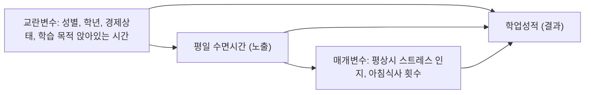

# C-1
- DAG 그림

- 공변량별 역할 분류 및 근거 표

| 변수명 (원변수) | 변수 정의 | 분류 역할 | 화살표 연결 근거 (시간 순서 및 선행연구) | 보정 여부 |
| :--- | :--- | :--- | :--- | :---: |
| SEX (`SEX`) | 조사 대상 학생의 성별 | 교란변수 (Confounder) | 선천적·생물학적 요인으로 수면 패턴과 학업 성취 경향에 모두 선행하여 영향을 미침 | 보정 O |
| GRADE (`GRADE`) | 중학교 1학년 ~ 고등학교 3학년 | 교란변수 (Confounder) | 학년이 올라갈수록 입시 부담으로 수면시간이 줄고 성적 분포 구조가 달라지므로 선행함 | 보정 O |
| E_SES (`E_SES`) | 가정의 경제적 상태 | 교란변수 (Confounder) | 가정환경은 양질의 수면 환경과 사교육·학습 자원에 모두 영향을 주는 공통 선행 요인임 | 보정 O |
| M_STR (`M_STR`) | 평상시 스트레스 인지 | 매개변수 / 애매한 변수 | 수면 부족이 스트레스를 유발하고, 이것이 성적에 영향을 미치는 경로에 위치함[cite: 7] | 민감도분석(모형 3) |
| PA_SWD_S (`PA_SWD_S`) | 주중 학습목적 앉아서 보낸 시간 | 매개변수 / 생활습관 | 수면을 줄여서 학습 시간을 늘리거나 부족한 수면이 집중력 저하로 학습 효율에 영향을 미침 | 민감도분석(모형 3) |
| F_BR (`F_BR`) | 최근 7일간 아침식사 횟수 | 공변량 / 건강행태 | 규칙적인 생활습관 지표로서 수면 상태와 건강·학업 성취에 복합적인 연관성을 가짐 | 민감도분석(모형 3) |

- 보정집합 (Adjustment Sets)

추정 대상 (Target Effect): 평일 수면시간이 주관적 학업성적에 미치는 총효과 (Total Effect)
최소보정집합 (Minimal Adjustment Set):
  $$\{\text{성별}, \text{학년}, \text{주관적 경제상태}, \text{학습 목적 앉아있는 시간}\}$$
보정집합 선정 근거:
인과구조(DAG) 상에서 노출변수(수면시간)와 결과변수(학업성적) 사이의 모든 허위 상관관계 경로(Backdoor paths)를 완벽히 차단하기 위해, 이론적 인과 관계가 검증된 4개의 외생 교란변수를 최소보정집합으로 선정함.
본 연구의 목적은 수면시간이 성적에 미치는 '총효과' 추정이므로, 수면시간의 하위 인과 경로에 위치한 매개변수들은 과잉조정 편향(Overcontrolling bias) 방지를 위해 보정집합에서 제외함.

---

- 역할이 애매한 변수 처리 및 민감도 분석 계획

애매한 변수의 역할 지정:
평상시 스트레스 인지(`M_STR`) 및 아침식사 횟수(`F_BR`): 수면 부족의 결과(매개)일 수도 있고, 반대로 불면이나 생활습관의 원인(교란)일 수도 있어 단일 역할로 확정하기 애매함.
처리 방식: 과잉조정 편향을 방지하고 순수한 총효과를 추정하기 위해, 주 분석 모형(모형 2)에서는 두 변수를 매개 경로로 간주하여 최소보정집합에서 제외함.
민감도 분석(모형 3)을 통한 확인 방법:
최소보정집합만 통제한 주 분석 모형(모형 2)에 두 변수를 추가로 투입한 모형 3을 구축함.
두 모형 간 수면시간의 회귀계수(OR 또는 $\beta$) 변화를 비교하여, 두 변수가 개입했을 때의 간접 효과 규모를 측정하고 최종 인과 추정 결과의 견고성을 확인함.
