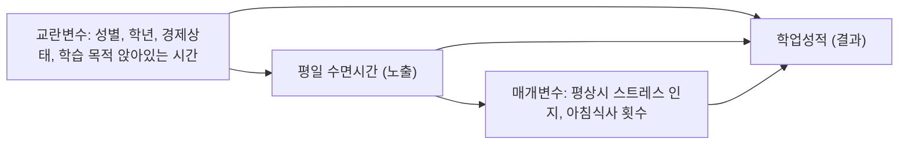

# C-1
- DAG 그림

- 공변량별 역할 분류 및 근거 표

| 변수명 (원변수) | 변수 정의 | 분류 역할 | 화살표 연결 근거 (시간 순서 및 선행연구) | 보정 여부 |
| :--- | :--- | :--- | :--- | :---: |
| SEX (`SEX`) | 조사 대상 학생의 성별 | 교란변수 (Confounder) | 선천적·생물학적 요인으로 수면 패턴과 학업 성취 경향에 모두 선행하여 영향을 미침 | 보정 O |
| GRADE (`GRADE`) | 중학교 1학년 ~ 고등학교 3학년 | 교란변수 (Confounder) | 학년이 올라갈수록 입시 부담으로 수면시간이 줄고 성적 분포 구조가 달라지므로 선행함 | 보정 O |
| E_SES (`E_SES`) | 가정의 경제적 상태 | 교란변수 (Confounder) | 가정환경은 양질의 수면 환경과 사교육·학습 자원에 모두 영향을 주는 공통 선행 요인임 | 보정 O |
| M_STR (`M_STR`) | 평상시 스트레스 인지 | 매개변수 / 애매한 변수 | 수면 부족이 스트레스를 유발하고, 이것이 성적에 영향을 미치는 경로에 위치함[cite: 7] | 민감도분석(모형 3) |
| PA_SWD_S (`PA_SWD_S`) | 주중 학습목적 앉아서 보낸 시간 | 매개변수 / 생활습관 | 수면을 줄여서 학습 시간을 늘리거나 부족한 수면이 집중력 저하로 학습 효율에 영향을 미침 | 민감도분석(모형 3) |
| F_BR (`F_BR`) | 최근 7일간 아침식사 횟수 | 공변량 / 건강행태 | 규칙적인 생활습관 지표로서 수면 상태와 건강·학업 성취에 복합적인 연관성을 가짐 | 민감도분석(모형 3) |

- 보정집합 (Adjustment Sets)

추정 대상 (Target Effect): 평일 수면시간이 주관적 학업성적에 미치는 총효과 (Total Effect)
최소보정집합 (Minimal Adjustment Set):
  $$\{\text{성별}, \text{학년}, \text{주관적 경제상태}, \text{학습 목적 앉아있는 시간}\}$$
보정집합 선정 근거:
인과구조(DAG) 상에서 노출변수(수면시간)와 결과변수(학업성적) 사이의 모든 허위 상관관계 경로(Backdoor paths)를 완벽히 차단하기 위해, 이론적 인과 관계가 검증된 4개의 외생 교란변수를 최소보정집합으로 선정함.
본 연구의 목적은 수면시간이 성적에 미치는 '총효과' 추정이므로, 수면시간의 하위 인과 경로에 위치한 매개변수들은 과잉조정 편향(Overcontrolling bias) 방지를 위해 보정집합에서 제외함.

---

- 역할이 애매한 변수 처리 및 민감도 분석 계획

애매한 변수의 역할 지정:
평상시 스트레스 인지(`M_STR`) 및 아침식사 횟수(`F_BR`): 수면 부족의 결과(매개)일 수도 있고, 반대로 불면이나 생활습관의 원인(교란)일 수도 있어 단일 역할로 확정하기 애매함.
처리 방식: 과잉조정 편향을 방지하고 순수한 총효과를 추정하기 위해, 주 분석 모형(모형 2)에서는 두 변수를 매개 경로로 간주하여 최소보정집합에서 제외함.
민감도 분석(모형 3)을 통한 확인 방법:
최소보정집합만 통제한 주 분석 모형(모형 2)에 두 변수를 추가로 투입한 모형 3을 구축함.
두 모형 간 수면시간의 회귀계수(OR 또는 $\beta$) 변화를 비교하여, 두 변수가 개입했을 때의 간접 효과 규모를 측정하고 최종 인과 추정 결과의 견고성을 확인함.

# C-2
-Table 2

| 수면군 및 분석구분 (구분) | 분석 인원 (N) | Model 1 (무보정) OR / $\beta$ | Model 1 95% CI | Model 1 p-value | Model 2 (최소보정) OR / $\beta$ | Model 2 95% CI | Model 2 p-value | Model 3 (확장보정) OR / $\beta$ | Model 3 95% CI | Model 3 p-value |
| :--- | :---: | :---: | :---: | :---: | :---: | :---: | :---: | :---: | :---: | :---: |
| **권장 수면충족군 [8-10시간]** | 43,562명 | 1.00 | Reference | - | 1.00 | Reference | - | 1.00 | Reference | - |
| **수면 부족군 [<8시간]**  (주 분석: 순서형 OR) | 43,562명 | 0.99 | 0.95 – 1.03 | 0.575 | 0.97 | 0.94 – 1.01 | 0.157 | 0.96 | 0.92 – 1.00 | 0.035 |
| **수면 부족군 [<8시간]**  (보조 분석: 연속형 $\beta$) | 43,562명 | -0.02 | -0.05 – 0.01 | 0.253 | -0.03 | -0.05 – -0.00 | 0.031 | -0.04 | -0.06 – -0.01 | 0.006 |

-각주

제21차(2025년도) 청소년건강행태조사 원시자료를 활용한 본 분석은 복합표본설계(층화변수, 집락변수, 가중치 적용)와 도메인 처리를 반영하였으며, 주 분석인 복합표본 로지스틱 회귀분석을 통한 오즈비(OR) 산출과 보조 분석인 복합표본 선형 회귀분석을 통한 회귀계수($\beta$) 산출을 수행했습니다. 분석 모형은 보정변수가 없는 Model 1(무보정), 성별·학년·경제상태·학습 목적 앉아있는 시간을 보정한 Model 2(최소보정), 그리고 평상시 스트레스 인지와 아침식사 횟수를 추가로 보정한 Model 3(확장보정)으로 구성하였으며, 주요 변수에 결측이 있는 경우를 제외하는 Complete Case Analysis를 적용하여 분석 인원을 산정했습니다.

# C-3

- 본 연구에서 주중 수면 부족군(<8시간)은 권장 수면충족군(8~10시간)에 비해 무보정 모형(Model 1)에서 주관적 학업성적 순서형 오즈비(OR) 0.99(95% CI: 0.95–1.03, p=0.575)로 뚜렷한 관련성이 관찰되지 않았으나, C-1의 DAG를 기반으로 교란변수와 학습시간을 보정한 최소보정 모형(Model 2, OR 0.97) 및 스트레스와 아침식사 횟수 등 애매한 변수를 추가한 확장보정 모형(Model 3, OR 0.96, p=0.035)으로 보정이 진행됨에 따라 계수의 크기가 점진적으로 변화하여 교란 및 매개 경로 통제에 따른 인과 효과 추정치의 차이를 나타내었다. 다만 본 연구는 한 시점의 단면 자료를 이용해 역방향 인과관계를 완전히 배제하기 어렵고, 측정되지 않은 교란 요인과 자기기입식 설문조사에 따른 측정 오차가 존재한다는 한계가 있으므로, 향후 12주차에는 애매한 변수를 넣고 뺀 모형 간 비교 및 결측치 처리 방식 변경 등의 민감도 분석을 통해 결과의 견고성을 추가로 확인할 계획이다.
