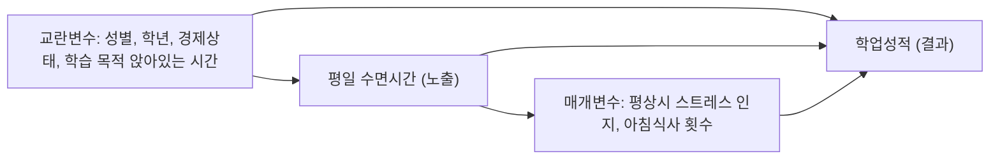

# 청소년의 주중 수면시간과 주관적 학업성적 간의 인과적 관계: 권장 수면시간 충족 여부를 중심으로

0.초록

  제21차(2025년) 청소년건강행태조사 원시자료(N=43,562)로 중1–고3 청소년의 주중 수면 부족(<8시간)과 주관적 학업성적 간의 관련성을 분석하였다. 코랩에서 복합표본 설계를 반영하여 모형 2(성별·학년·경제상태·학습앉은시간 보정)를 주 분석으로 적합하고 순서형·연속형 분석을 민감도분석으로 수행하였다. 분석 결과, 수면 부족군과 학업성적의 오즈비(OR)는 1.04(95% CI: 0.99–1.10, p=0.130), 유병률비(PR)는 1.03(95% CI: 1.00–1.05, p=0.068)으로 통계적 유의성은 없었다. 10시간 초과 제외, 자기기입 응답, 성적 스트레스→수면 부족 역방향 인과 한계를 고려할 때, 수면 부족과 학업성적 간 일관된 유의적 관련성은 확인되지 않았다.

1. 서론

  청소년기의 적정 수면은 인지 기능과 집중력 유지, 학습 효율을 뒷받침하는 핵심 생리적 요인이다. 그러나 한국 청소년은 학년이 올라갈수록 입시 및 학습 부담이 가중되면서 주중 수면시간이 급격히 줄어드는 특성을 보인다. 특히 보건당국 및 미국수면의학회(AASM)가 제시하는 청소년 권장 수면시간(8–10시간)에 미달하는 수면 부족 상태가 일상화되면서, 수면 부족과 학업성취 사이의 관련성을 실증적으로 규명할 필요성이 제기되고 있다.
  
  기존 연구 및 단순 설문 문항 기반 분석에서는 수면시간을 단편적으로 측정하거나, 학업성적과 수면시간 모두에 선행하여 영향을 미치는 인구사회학적·학습시간 교란요인과 수면 부족의 하위 경로에 놓인 매개변수를 구분하지 않아 관련성 해석에 한계가 있었다. 반면 수면 부족이 학업성적에 미치는 전체적인 관련성(총효과, Total Effect)을 평가하기 위해서는 유향비순환그래프(DAG)를 통해 교란경로만 적절히 차단하고, 수면시간의 하위 경로에 위치한 매개변수는 통제하지 않는 분석 전략이 요구된다.
  
  이에 본 연구는 전국 대표성을 갖춘 제21차(2025년) 청소년건강행태조사 원시자료를 활용하여 대한민국 중1–고3 청소년의 주중 수면시간 부족(<8시간)과 주관적 학업성적 간의 관련성을 복합표본 분석으로 검증하고자 한다. 구체적으로 이분형 로지스틱 회귀 모형 2를 주 분석으로 설정하여 동일한 이분형 결과의 오즈비(OR)와 유병률비(PR)를 비교 제시하고, 보정변수 확장 및 결과변수 척도 변경(순서형·연속형)을 민감도분석으로 수행하여 결과의 견고성을 평가한다.

2. 방법

2.1. 연구 설계 및 자료원

본 연구는 질병관리청이 수행한 제21차(2025년) 청소년건강행태조사(Korea Youth Risk Behavior Survey, KYRBS) 원시자료를 활용한 단면연구(Cross-sectional study)이다. 청소년건강행태조사는 층화집락추출법(Stratified Cluster Sampling)으로 표집된 복합표본설계 자료이며, 모든 데이터 전처리와 통계 분석은 구글 코랩(Google Colab) 환경에서 Python을 사용하여 수행하였다.

2.2. 연구 대상자 선정

  질병관리청 제21차(2025년) 청소년건강행태조사 원시자료로부터 분석 대상자를 단계별로 선정한 과정은 다음과 같다.
  
  전체 조사 참여자 54,170명(가중 추정 모집단 2,642,704명)을 대상으로 연구대상자를 선정하였다(1단계). 학년 변수(GRADE)를 기준으로 중학교 1학년부터 고등학교 3학년까지의 재학생을 확인하였으며, 전체 응답자가 연구대상자 선정 기준에 부합하여 학년 기준에 따른 제외자는 없었다(2단계). 주중 평균 수면시간은 주중 취침 시각과 기상 시각을 이용하여 산출하였다. 수면시간의 타당성을 확보하기 위해 2시간 미만 또는 18시간 초과의 비현실적인 값과 10시간 초과에 해당하는 응답자 10,027명(18.51%)을 제외하였다. 이에 따라 수면 부족군(8시간 미만)과 권장 수면충족군(8시간 이상 10시간 이하)에 해당하는 44,143명(가중 추정 모집단 2,166,085명)을 선정하였다(3단계). 이후 결과변수인 주관적 학업성적(E_S_RCRD)에 결측값이 있는 5명을 추가로 제외하여 최종 분석 대상자는 총 44,138명으로 확정하였다(가중 추정 모집단 2,165,847명)(4단계). 최종 분석 대상자 중 권장 수면충족군은 23,399명, 수면 부족군은 20,739명이었다. 따라서 최종 회귀분석 대상자(완전 사례 분석, Table 2 및 Table 3)는 기본 분석 대상자 중 주요 공변량 결측자(E_SES 4명, PA_SWD_S 573명 등 총 576명)를 회귀분석 직전에 제외한 완전 사례 43,562명(권장 수면충족군 23,098명, 수면 부족군 20,464명)으로 구성하였다.

2.3. 변수 정의

  노출변수인 주중 수면시간 군은 단일 설문 문항 대신 주중 취침 시각(M_SLP_HR_K, M_SLP_MM_K)과 기상 시각(M_WK_HR_K, M_WK_MM_K) 원변수를 조합하여 24시 응답을 0시로 변환하고 자정 넘김을 보정한 뒤 개별 응답자의 주중 일평균 수면시간(SLEEP_HR)을 직접 산출하여 구성하였다. 이를 바탕으로 보건당국 및 AASM 권장 수면시간을 충족한 권장 수면충족군(8–10시간)을 기준군(Reference)으로, 수면 부족군(<8시간)을 노출군(Exposure)으로 정의하였다.
  
  결과변수인 주관적 학업성적은 최근 12개월 동안의 주관적 학업성적(E_S_RCRD, ①상, ②중상, ③중, ④중하, ⑤하)을 활용하였다. 주 분석에서는 1·2등급('상·중상')을 1로, 3·4·5등급('나머지')을 0으로 이분화하여 정의하였으며, 민감도분석에서는 5단계 순서형 척도(0–4코딩)와 1–5점 연속형 척도를 함께 검토하였다.
  
  공변량 및 보정집합의 경우, 선행연구와 시간적 선후관계를 반영한 DAG를 바탕으로 총효과 추정을 위한 최소보정집합(Minimal Adjustment Set)으로 성별(SEX), 학년(GRADE), 가정 경제 상태(E_SES), 주중 학습목적 앉아서 보낸 시간(PA_SWD_S, 분/일)을 선정하였다. 또한 수면 부족의 매개변수이자 교란변수 후보인 평상시 스트레스 인지(M_STR)와 건강행태 공변량인 최근 7일간 아침식사 횟수(F_BR)는 과잉조정 편향(Overcontrolling bias)을 방지하기 위해 주 분석 보정집합에서는 제외하고 민감도분석 확장모형(Model 3)에만 포함하였다. 
  
2.4. 통계 분석

  기술통계(Table 1)에서는 이용지침서에 따라 층화변수(STRATA), 집락변수(CLUSTER), 단년도 분석용 가중치(W)를 반영한 가중 백분율과 테일러 선형화 기반 설계 표준오차(Design SE)를 비가중 빈도·비율과 함께 산출하였다. 주 분석에서는 완전 사례(N=43,562)를 대상으로 이분형 주관적 학업성적에 대한 복합표본 이분형 로지스틱 회귀분석(모형 2: 성별·학년·경제상태·학습앉은시간 보정)을 적합하여 오즈비(OR)와 95% 신뢰구간(CI)을 추정하였다. 회귀분석 모형의 표준오차는 가중치(W)와 집락(CLUSTER)을 반영한 군집 강건 표준오차(cluster-robust SE)를 적용하였다.
  
  민감도분석에서는 동일한 완전 사례(N=43,562)에서 ① 흔한 이분형 결과에서의 OR 과대추정 여부를 점검하기 위한 로그 연결 포아송 회귀 기반 유병률비(PR, 모형 2 보정), ② 평상시 스트레스 인지(M_STR)와 아침식사 횟수(F_BR)를 추가 보정한 확장보정 모형(모형 3), ③ 학업성적 5단계 척도를 유지한 복합표본 순서형 로지스틱 회귀(모형 1–3) 및 1–5점 등간척도를 가정한 가중 최소제곱(WLS) 연속형 선형 회귀(모형 1–3)를 수행하여 결과의 견고성을 검증하였다.

3. 결과

3.1. DAG 흐름도

3.2. 연구 대상자의 일반적 특성 (Table 1)

  기본 분석 대상자 44,138명 중 권장 수면충족군은 23,399명, 수면 부족군은 20,739명이었다. 전체 대상자에서 비가중 비율과 가중 백분율 간 절대 격차가 가장 큰 상위 3개 항목은 고등학교 3학년(비가중 16.77% vs. 가중 17.82%, 격차 1.05%p), 가정 경제 상태 '중상'(비가중 31.58% vs. 가중 32.34%, 격차 0.76%p), '중'(비가중 47.00% vs. 가중 46.36%, 격차 0.64%p)으로 확인되어 복합표본 가중치 보정의 필요성을 뒷받침하였다. 수면 부족군은 권장 수면충족군에 비해 여학생 비율(가중 52.09% vs. 46.37%)과 고등학생 비율(고3 기준 가중 21.52% vs. 14.48%)이 높았으며, 주중 학습목적 앉아서 보낸 시간의 가중 평균(SE) 또한 474.3분(3.41)으로 권장 수면군 425.0분(2.50)보다 길었다.

Table 1. 연구 대상자의 주중 수면시간 군별 일반적 특성 및 분포 (N = 44,138)
| 연구 변수 및 범주 | 구분 | 전체 대상자 (N=44,138) n / 비가중 % / 가중 % (SE) | 권장 수면군 [8-10시간] (N=23,399) n / 비가중 % / 가중 % (SE) | 수면 부족군 [<8시간] (N=20,739) n / 비가중 % / 가중 % (SE) |
| :--- | :--- | :---: | :---: | :---: |
| **성별 (`SEX`)** | 남성 | 22,370 (50.68% / 50.92%) | 12,489 (53.37% / 53.63%) | 9,881 (47.64% / 47.91%) |
| | 여성 | 21,768 (49.32% / 49.08%) | 10,910 (46.63% / 46.37%) | 10,858 (52.36% / 52.09%) |
| **학년 (`GRADE`)** | 중학교 1학년 | 7,051 (15.97% / 15.64%) | 4,523 (19.33% / 19.06%) | 2,528 (12.19% / 11.85%) |
| | 중학교 2학년 | 7,374 (16.71% / 16.33%) | 4,383 (18.73% / 18.46%) | 2,991 (14.42% / 13.98%) |
| | 중학교 3학년 | 7,488 (16.96% / 16.72%) | 4,336 (18.53% / 18.30%) | 3,152 (15.20% / 14.98%) |
| | 고등학교 1학년 | 7,391 (16.75% / 16.49%) | 3,529 (15.08% / 14.98%) | 3,862 (18.62% / 18.17%) |
| | 고등학교 2학년 | 7,430 (16.83% / 17.00%) | 3,401 (14.53% / 14.72%) | 4,029 (19.43% / 19.52%) |
| | 고등학교 3학년 | 7,404 (16.77% / 17.82%) | 3,227 (13.79% / 14.48%) | 4,177 (20.14% / 21.52%) |
| **가정 경제 상태 (`E_SES`)** | 상 | 4,632 (10.49% / 10.96%) | 2,413 (10.31% / 10.87%) | 2,219 (10.70% / 11.05%) |
| | 중상 | 13,940 (31.58% / 32.34%) | 7,286 (31.14% / 31.72%) | 6,654 (32.08% / 33.03%) |
| | 중 | 20,743 (47.00% / 46.36%) | 11,153 (47.66% / 47.06%) | 9,590 (46.24% / 45.59%) |
| | 중하 | 4,049 (9.17% / 8.71%) | 2,137 (9.13% / 8.71%) | 1,912 (9.22% / 8.72%) |
| | 하 | 770 (1.74% / 1.61%) | 407 (1.74% / 1.62%) | 363 (1.75% / 1.60%) |
| | 결측 (Missing) | 4 (0.01% / 0.01%) | 3 (0.01% / 0.01%) | 1 (0.00% / 0.01%) |
| **평상시 스트레스 인지 (`M_STR`)** | 대단히 많이 느낌 | 4,911 (11.13% / 11.18%) | 2,016 (8.62% / 8.66%) | 2,895 (13.96% / 13.96%) |
| | 많이 느낌 | 13,535 (30.67% / 30.73%) | 6,564 (28.05% / 28.29%) | 6,971 (33.61% / 33.44%) |
| | 조금 느낌 | 18,862 (42.73% / 42.90%) | 10,585 (45.24% / 45.34%) | 8,277 (39.91% / 40.21%) |
| | 별로 느끼지 않음 | 5,663 (12.83% / 12.65%) | 3,505 (14.98% / 14.74%) | 2,158 (10.41% / 10.35%) |
| | 전혀 느끼지 않음 | 1,167 (2.64% / 2.54%) | 729 (3.12% / 2.98%) | 438 (2.11% / 2.05%) |
| **최근 7일간 아침식사 횟수 (`F_BR`)** | 주 0일 | 11,530 (26.12% / 26.19%) | 6,116 (26.14% / 26.27%) | 5,414 (26.11% / 26.11%) |
| | 주 1일 | 3,518 (7.97% / 7.89%) | 1,747 (7.47% / 7.30%) | 1,771 (8.54% / 8.53%) |
| | 주 2일 | 4,178 (9.47% / 9.42%) | 2,210 (9.44% / 9.35%) | 1,968 (9.49% / 9.49%) |
| | 주 3일 | 3,340 (7.57% / 7.35%) | 1,740 (7.44% / 7.22%) | 1,600 (7.71% / 7.49%) |
| | 주 4일 | 2,644 (5.99% / 5.91%) | 1,384 (5.91% / 5.81%) | 1,260 (6.08% / 6.03%) |
| | 주 5일 | 4,835 (10.95% / 10.83%) | 2,695 (11.52% / 11.38%) | 2,140 (10.32% / 10.22%) |
| | 주 6일 | 2,785 (6.31% / 6.33%) | 1,387 (5.93% / 5.96%) | 1,398 (6.74% / 6.74%) |
| | 주 7일 (매일) | 11,308 (25.62% / 26.09%) | 6,120 (26.15% / 26.72%) | 5,188 (25.02% / 25.38%) |
| **주관적 학업성적 (`E_S_RCRD`, 결과변수)** | 상 (1) | 5,290 (11.99% / 12.21%) | 2,838 (12.13% / 12.34%) | 2,452 (11.82% / 12.07%) |
| | 중상 (2) | 11,524 (26.11% / 26.40%) | 6,084 (26.00% / 26.25%) | 5,440 (26.23% / 26.57%) |
| | 중 (3) | 12,830 (29.07% / 29.01%) | 6,732 (28.77% / 28.57%) | 6,098 (29.40% / 29.50%) |
| | 중하 (4) | 10,407 (23.58% / 23.27%) | 5,506 (23.53% / 23.34%) | 4,901 (23.63% / 23.19%) |
| | 하 (5) | 4,087 (9.26% / 9.11%) | 2,239 (9.57% / 9.51%) | 1,848 (8.91% / 8.66%) |
| **주중 학습목적 앉아서 보낸 시간 (`PA_SWD_S`)** | 가중 평균(SE) / 비가중 평균(SD) [분/일] | N=43,565 448.4 (2.62) / 444.0 (243.9) | N=23,100 425.0 (2.50) / 420.1 (236.1) | N=20,465 474.3 (3.41) / 470.9 (249.6) |
| | 결측 (Missing) | 573 (1.30% / -) | 299 (1.28% / -) | 274 (1.32% / -) |

주: 본 표의 n은 가중치가 적용되지 않은 비가중 표본 관측 수를 의미하며, 가중 백분율(%)과 가중 평균은 복합표본설계를 반영한 가중 추정치임. 범주형 변수는 가중 백분율과 표준오차(SE)로 제시하였고, 연속형 변수인 '주중 학습목적 앉아서 보낸 시간(PA_SWD_S)'은 가중 평균 및 표준오차와 비가중 평균 및 표준편차(SD)로 요약하였음. 권장 수면군(8~10시간)과 수면 부족군(<8시간) 간의 집단별 특성 비교에는 표준화된 평균 차이(SMD)를 활용하였으며, SMD가 0.10을 초과할 때 두 집단 간 불균형이 존재하는 것으로 판단하였음. 아울러 가정 경제 상태(E_SES, n=4)와 주중 학습목적 앉아서 보낸 시간(PA_SWD_S, n=573)의 결측치는 표 상에 독립된 '결측(Missing)' 범주로 명시하였고, 최종 다중변수 분석 시에는 해당 결측을 제외한 완전 케이스 분석(Complete-case analysis)을 적용하였음.

3.3. 주 분석: 주중 수면 부족과 주관적 학업성적의 관련성 (Table 2)

  공변량 결측을 제외한 완전 사례 43,562명을 대상으로 주관적 학업성적을 이분화('상·중상' 대 '나머지')한 복합표본 이분형 로지스틱 회귀분석을 수행한 결과, 수면 부족군(<8시간)은 권장 수면충족군(8–10시간)에 비해 무보정 모형(Model 1)에서 오즈비(OR) 1.00(95% CI: 0.95–1.05, p=0.934)으로 통계적으로 유의한 관련성이 관찰되지 않았다. DAG 기반 최소보정집합(성별, 학년, 가정 경제 상태, 주중 학습목적 앉아서 보낸 시간)을 통제한 주 분석 모형(Model 2)에서도 OR 1.04(95% CI: 0.99–1.10, p=0.130)로 유의하지 않았으며, 평상시 스트레스 인지와 최근 7일간 아침식사 횟수를 추가로 보정한 확장모형(Model 3) 역시 OR 1.04(95% CI: 0.99–1.10, p=0.099)로 일관된 비유의적 결과를 보였다. 또한 동일한 이분형 결과변수와 모형 2 보정변수를 적용한 로그 연결 포아송 회귀의 유병률비(PR)도 1.03(95% CI: 1.00–1.05, p=0.068)으로 나타나, 오즈비와 유병률비 모두에서 주중 수면 부족과 학업성적 '상·중상' 여부 간 통계적으로 유의한 관련성은 확인되지 않았다.

| 구분 | 분석 인원 (N) | Model 1 (무보정) OR | Model 1 (무보정) 95% CI | Model 1 (무보정) p-value | Model 2 (최소보정: 주 분석) OR | Model 2 (최소보정: 주 분석) 95% CI | Model 2 (최소보정: 주 분석) p-value | Model 3 (확장보정) OR | Model 3 (확장보정) 95% CI | Model 3 (확장보정) p-value |
| :--- | :---: | :---: | :---: | :---: | :---: | :---: | :---: | :---: | :---: | :---: |
| **권장 수면충족군 [8–10시간]** | 43,562명 | 1.00 | Reference | - | 1.00 | Reference | - | 1.00 | Reference | - |
| **수면 부족군 [<8시간] (이분형 로지스틱 OR)** | 43,562명 | 1.00 | 0.95 – 1.05 | 0.934 | 1.04 | 0.99 – 1.10 | 0.130 | 1.04 | 0.99 – 1.10 | 0.099 |

주: 제21차(2025년도) 청소년건강행태조사 원시자료를 활용한 본 분석은 복합표본설계(층화변수, 집락변수, 가중치 적용)와 도메인 처리를 반영하였으며, 주관적 학업성적 5단계를 1·2등급인 '상·중상'과 3·4·5등급인 '나머지'로 묶어 이분화한 뒤 복합표본 로지스틱 회귀분석을 통해 오즈비(OR), 95% 신뢰구간(95% CI), p-value를 산출하는 것을 주 분석으로 수행함(기준집단: 권장 수면충족군 [8–10시간]). 보조 분석으로는 성적 점수를 1-5점의 연속형으로 다룬 복합표본 선형 회귀분석을 통해 회귀계수(β) 산출을 함께 수행함. 이때 회귀분석의 표준오차(SE)는 집락만 반영한 군집 강건 표준오차(cluster-robust SE)를 적용하였으며, 층화변수는 반영하지 않은 근사치임. 분석 모형은 보정변수가 없는 Model 1(무보정), 성별·학년·경제상태·학습 목적 앉아있는 시간을 보정한 Model 2(최소보정), 그리고 평상시 스트레스 인지와 아침식사 횟수를 추가로 보정한 Model 3(확장보정)으로 구성하였으며, 주요 변수에 결측이 있는 경우를 제외하는 Complete Case Analysis를 적용하여 분석 인원(N=43,562명)을 산정함.

3.4. 민감도분석 결과 (Table 3)

  모형 가정 및 결과변수 척도 정의에 따른 결과의 견고성을 확인하기 위해 민감도분석을 수행하였다. 첫째, 동일한 이분형 결과변수('상·중상' vs. '나머지')에서 주 분석 오즈비(OR=1.04)와 유병률비(PR=1.03) 간의 차이는 -0.01로 미미하여 이분형 오즈비의 과대추정 문제가 거의 없음을 확인하였다. 둘째, 평상시 스트레스 인지(M_STR)와 최근 7일간 아침식사 횟수(F_BR)를 추가로 보정한 이분형 확장보정 모형(S1, 모형 3)에서도 OR=1.04(95% CI: 0.99–1.10, p=0.099)로 주 분석과 동일한 효과 크기 및 비유의적 결론이 유지되었다. 셋째, 학업성적 5단계 범주를 보존한 순서형 로지스틱 회귀분석(S2)에서는 무보정 모형 1(OR=0.99, 95% CI: 0.95–1.03, p=0.575)과 최소보정 모형 2(OR=0.97, 95% CI: 0.94–1.01, p=0.157)에서는 유의하지 않았으나, 스트레스와 아침식사를 추가한 확장보정 모형 3(OR=0.96, 95% CI: 0.92–1.00, p=0.035)에서 경계선상의 통계적 유의성이 나타났다. 넷째, 학업성적 5단계 척도를 1–5점 연속형 점수로 가정한 가중 최소제곱(WLS) 선형 회귀분석(S3)에서는 무보정 모형 1(β=-0.02, 95% CI: -0.05–0.01, p=0.253)을 제외한 최소보정 모형 2(β=-0.03, 95% CI: -0.05–-0.00, p=0.031)와 확장보정 모형 3(β=-0.04, 95% CI: -0.06–-0.01, p=0.006)에서 유의한 관련성이 관찰되었다.

| 분석 구분 | 적용 모델 및 가정 (바꾸는 가정) | 분석 인원 (N) | 효과 크기 (OR / PR / β) | 95% 신뢰구간 (95% CI) | p-값 (p-value) | 주 분석과의 차이 및 민감도 해석 |
| :--- | :--- | :---: | :---: | :---: | :---: | :--- |
| **주 분석 (Main Analysis)** | 이분형 로지스틱 회귀 (상·중상 vs 나머지, 모형 2 최소보정: 성별·학년·경제상태·학습시간) | 43,562명 | 1.04 | 0.99 – 1.10 | 0.130 | 기준 모형 (동일 이분형 결과의 오즈비 OR 기준) |
| **S-유병률비 (필수 민감도)** | 동일 이분형 결과(상·중상 vs 나머지) 및 모형 2 보정변수로 포아송 회귀(로그 연결) PR 산출 | 43,562명 | 1.03 | 1.00 – 1.05 | 0.068 | 동일 이분형 OR(1.04) 대비 PR(1.03) 차이 -0.01; 방향성 일치 및 OR 과대추정 여부 비교 |
| **S1 매개 후보 보정** | 동일 이분형 로지스틱 모형 2에 평상시 스트레스(M_STR)와 아침식사 횟수(F_BR) 추가 보정(모형 3) | 43,562명 | 1.04 | 0.99 – 1.10 | 0.099 | 주 분석 OR(1.04) 대비 확장보정 OR(1.04) 변화 확인 (매개·교란 후보 추가 통제 시 민감도) |
| **S3 결과 정의 변경** | 학업성적 척도를 이분형 대신 연속형 점수(1-점)로 가정하여 선형 회귀(WLS, 모형 2 보정) 적용 | 43,562명 | -0.03 | -0.05 – -0.00 | 0.031 | 연속형 회귀계수 β(-0.03) 산출; 척도 정의를 연속형으로 변경했을 때의 효과 방향성 및 유의성 비교 |

주: 질병관리청 제21차(2025년) 청소년건강행태조사 원시자료(N=43,562). 주 분석·S1·S3는 층화(strata)·집락(cluster)·가중치(weight)를 모두 반영한 복합표본 분석을 수행하였으며, S-유병률비는 가중치(W) 및 집락(CLUSTER) 로버스트 표준오차만 적용한 근사 추정(층화변수 미반영)으로 산출함. 기준 모형(주 분석)은 학업성적을 이분형으로 정의하고 성별·학년·경제상태·학습시간을 보정한 복합표본 이분형 로지스틱 회귀(모형 2)이며, 민감도 분석은 각각 S-유병률비(동일한 이분형 결과변수 및 모형 2 보정변수에 로그 연결 포아송 회귀를 적용한 PR 추정), S1(동일한 이분형 로지스틱 모형 2에 평상시 스트레스 인지 M_STR 및 아침식사 횟수 F_BR 추가 보정), S3(학업성적 5단계 척도를 1~5점 등간척도로 가정한 복합표본 선형 회귀[WLS] 적용)로 변경하여 수행함.

4. 고찰
4.1. 주요 결과 요약
   
  본 연구는 제21차(2025년) 청소년건강행태조사 원시자료의 완전 사례 43,562명을 대상으로 대한민국 중1–고3 청소년의 주중 수면시간 부족(<8시간)과 주관적 학업성적 간의 관련성을 복합표본 회귀분석으로 검토하였다. 주 분석인 이분형 로지스틱 회귀(모형 2)에서 수면 부족군은 권장 수면충족군(8–10시간)에 비해 상위 성적('상·중상')에 속할 오즈비가 1.04(95% CI: 0.99–1.10, p=0.130)였고, 동일 결과와 보정변수로 추정한 유병률비 역시 1.03(95% CI: 1.00–1.05, p=0.068)으로 나타나 두 지표 모두 통계적으로 유의한 관련성이 확인되지 않았다. 이러한 비유의적 결론은 스트레스 인지와 아침식사 횟수를 추가 보정한 이분형 확장모형(S1: OR=1.04, p=0.099)에서도 동일하게 유지되었으나, 학업성적을 5단계 순서형(모형 3 OR=0.96, p=0.035) 또는 1–5점 연속형 척도(S3 모형 2 β=-0.03, p=0.031)로 다룬 민감도분석에서는 통계적 유의성이 관찰되었다.

4.2. 결과에 대한 가능한 설명

주 분석에서 주중 수면 부족과 주관적 학업성적 간 뚜렷한 유의적 관련성이 나타나지 않은 이유는 크게 두 가지 측면에서 해석할 수 있다. 첫째, 한국 청소년 특유의 학업 행태와 상반된 경로의 상쇄 효과이다. 생리적으로는 충분한 수면이 집중력과 인지 기능을 높여 학업성적과 긍정적 관련성을 보일 수 있으나, 실제 입시 환경에서는 학업 성취도가 높거나 성적 유지를 위해 노력하는 학생들이 학습 시간을 확보하고자 스스로 수면을 줄이는 경향이 공존한다. 실제로 Table 1에서도 수면 부족군의 주중 학습목적 앉은 시간(가중 평균 474.3분)이 권장 수면군(425.0분)보다 약 49분 더 길었으며, 이러한 상반된 방향의 관련성이 혼재하면서 이분형 주 분석의 전체 추정치가 귀무가설 값(1.00) 부근으로 희석되었을 가능성이 있다. 둘째, 결과변수의 조작적 정의(이분형 범주화 vs. 다범주·연속형 척도)에 따른 정보량 차이이다. 성적을 '상·중상'과 '나머지'로 이분화할 경우 중·중하·하위권 내부의 세부적인 성적 분포 변화 정보가 소실되어 통계적 유의성이 사라지는 반면, 5단계 성적 전체의 변동을 반영하는 연속형 분석에서는 미세한 차이가 포착되는 양상을 보였다.

4.3. 연구의 강점과 한계

  본 연구는 전국 대표성을 확보한 최신(2025년) 국가승인통계 원시자료를 사용하고, 복합표본 설계 요소(층화·집락·가중치)를 반영하여 편향을 줄였다는 강점이 있다. 또한 단일 설문 문항이 아닌 주중 취침·기상 시각 원변수를 조합해 실제 수면시간을 정밀 산출하였고, DAG 기반 변수 선정과 함께 주 분석(OR·PR 동시 제시) 및 다양한 척도·모형 민감도분석을 체계적으로 수행하여 결론이 어떤 분석 가정에 민감한지 투명하게 규명하였다.

  그러나 본 연구에는 다음과 같은 세 가지 주요 한계가 존재한다. 첫째는 10시간 초과 수면 집단의 제외이다. 병리적 과다수면이나 우울감, 무단결석 등 비정형적 교란 요인의 개입을 줄이기 위해 주중 수면시간 10시간 초과 집단을 분석 대상에서 제외함으로써 전체 청소년 중 과다수면 군의 학업성적 분포와 U자형 비선형 관련성 가능성을 평가하지 못하였으며, 연구 결과의 일반화 범위가 주중 10시간 이하 수면 청소년으로 제한된다. 둘째는 자기기입식 설문 기반 측정 오차이다. 노출변수인 주중 취침·기상 시각과 결과변수인 주관적 학업성적 모두 학생 본인의 자기기입식(Self-reported) 응답에 의존하였기 때문에 실제 객관적 수면시간(액티그래피 등)이나 실제 성적 등급과의 괴리, 회상 편향 및 사회적 바람직성 편향에 따른 비차등적·차등적 오분류 가능성을 배제할 수 없다. 셋째는 단면연구 설계로 인한 역방향 인과 가능성이다. 특정 시점의 횡단면 조사 자료를 분석하였기 때문에 변수 간 시간적 선후관계를 확정할 수 없으며, 특히 수면 부족이 학업성적과 연관되는 경로뿐만 아니라 학업 부담과 성적 스트레스로 인해 취침 시각이 늦어져 수면 부족이 유발되는 역방향 인과(성적 스트레스 → 수면 부족) 가능성이 존재한다.

4.4. 결론

  제21차(2025년) 청소년건강행태조사 복합표본 분석 결과, 대한민국 중1–고3 청소년의 주중 수면시간 부족(<8시간)과 주관적 학업성적('상·중상' 여부) 간에는 인구사회학적 요인 및 학습시간을 보정한 주 분석(OR=1.04, PR=1.03)에서 통계적으로 유의한 관련성이 확인되지 않았다. 다만 성적 척도를 연속형으로 정의하거나 매개·교란 후보 변수를 추가 통제한 일부 민감도분석에서는 유의성이 관찰되어, 두 변수 간의 관련성 해석은 결과변수의 척도 정의 방식과 모형 가정에 민감하게 좌우됨을 확인하였다. 향후 연구에서는 객관적 수면 및 성적 지표를 도입하고, 성적 스트레스와 수면시간 간의 역방향 인과 경로를 규명할 수 있는 종단적 추적 자료 분석이 필요하다.
